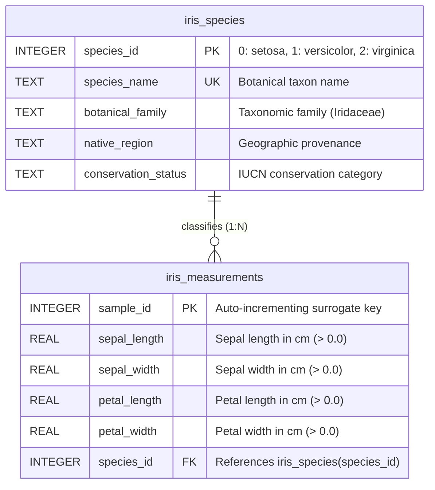

# Iris ML Pipeline: End-to-End Production Machine Learning Pipeline 🌸🚀

[](https://www.python.org/)
[](https://scikit-learn.org/)
[](https://www.sqlite.org/)
[](https://mypy-lang.org/)
[](https://docs.pytest.org/)
[](https://github.com/parth-mehta95/sahkaarx-stage-portfolio-571306d0)
[](https://opensource.org/licenses/MIT)

An end-to-end, production-grade Machine Learning pipeline foundation for the classic Iris classification task, developed as the flagship capstone project for the **SahkaarX Stage Portfolio**.

- **Capstone Repository:** [https://github.com/parth-mehta95/sahkaarx-stage-portfolio-571306d0](https://github.com/parth-mehta95/sahkaarx-stage-portfolio-571306d0)
- **Primary Branch:** `main`
- **Key Deliverables:** Data Loader, Validation Suite, Relational SQL Schema & Queries, SQL Feature Engineering, ML Models with Hungarian Cluster Alignment, Serialized Model Artifacts, and Integration Testing.

---

## 📌 Capstone Pipeline Architecture

The capstone project establishes a complete machine learning lifecycle decomposed into six decoupled, robust phases:


### 1. Phase 1: Project Scaffolding & Version Control
- Established standardized `.gitignore` ensuring caches, virtual environments, and untracked binaries are ignored while keeping model manifests and schema DDL.
- Pinned dependency contracts in `requirements.txt` (`numpy`, `pandas`, `scikit-learn`, `joblib`, `scipy`, `pytest`).
- Strict branch management policies and clean semantic commit messages across all feature branches.

### 2. Phase 2: Data Ingestion & Validation (`data_loader.py`, `validation_functions.py`)
- Type-hinted `load_iris()` interface supporting multiple output representations (`as_frame`, `return_X_y`).
- Comprehensive validation suite enforcing 2D shape, strictly positive morphological bounds, target class ranges, and dataset pair consistency.

### 3. Phase 3: Relational Persistence & Feature Engineering (`schema.sql`, `sql_queries.py`, `sql_features.py`)
- Normalized SQLite relational database schema (`iris_species` dimension table, `iris_measurements` fact table, performance indexes).
- Parameterized `SELECT` queries with pagination and SQL-injection defense.
- Relational `INNER JOIN` queries with botanical taxonomy enrichment.
- Advanced SQL feature engineering: observation ratios, species benchmark CTEs, size tier discretization, and class separability summaries.

### 4. Phase 4: Data Preprocessing & Leak-Free Feature Scaling (`preprocess()`)
- `StandardScaler` integration normalizing features to zero mean ($\mu = 0$) and unit variance ($\sigma = 1$).
- Stratified train-test partitioning (`test_size=0.2`, `stratify=y`) ensuring balanced class distributions.
- Leak-free transformation pipeline: the scaler is fitted solely on the training partition and transforms the test partition.

### 5. Phase 5: Model Exploration, Training & Bipartite Alignment (`models.py`, `metrics.csv`, `models/`)
- Supervised white-box classifier: `DecisionTreeClassifier(max_depth=3, criterion='gini')`.
- Supervised ensemble classifier: `RandomForestClassifier(n_estimators=100, max_depth=3)`.
- Unsupervised centroid clustering: `KMeans(n_clusters=3)`.
- Optimal Bipartite Matching: Kuhn-Munkres (Hungarian) algorithm mapping arbitrary cluster IDs to ground-truth species labels.
- Artifact serialization: Estimator binaries persisted via `joblib` into `models/`.

### 6. Phase 6: Automated Integration Testing & Deployment (`pipeline.py`, `test_pipeline.py`)
- Unified `pipeline.py` script executing the entire end-to-end pipeline in a single command.
- Complete pytest integration test suite `test_pipeline.py` verifying module compatibility, schema integrity, and benchmark thresholds.

---

## 📂 Repository Structure

```text
sahkaarx-stage-portfolio-571306d0/
├── .gitignore               # Version control ignore rules (permitting model manifests & schema)
├── requirements.txt         # Pinned core dependencies (numpy, pandas, scikit-learn, joblib, scipy, pytest)
├── README.md                # Comprehensive capstone documentation & pipeline specifications
├── schema.sql               # Normalized SQLite DDL schema with tables, indexes, views, and seed data
├── data_loader.py           # Type-hinted Iris data loader and leak-free preprocessing module
├── validation_functions.py  # Type-hinted Iris data validation and contract enforcement module
├── sql_queries.py           # Type-hinted relational SQLite query module (SELECT, JOIN, GROUP BY)
├── sql_features.py          # Type-hinted SQL aggregation and feature engineering module
├── models.py                # Decision Tree, Random Forest & K-Means module with Hungarian alignment
├── metrics.csv              # Model performance benchmark comparison table
├── iris_model_comparison.ipynb # Interactive Jupyter Notebook demonstration
├── pipeline.py              # End-to-end unified pipeline orchestrator
├── test_pipeline.py         # Complete pytest integration test suite
├── models/                  # Serialized model artifacts and metadata
│   ├── .gitkeep             # Git directory persistence marker
│   ├── model_manifest.json  # Model metadata, hyperparameters, and benchmark metrics
│   ├── README.md            # Model deserialization and inference documentation
│   └── export_models.py     # Standalone script to train and export model binaries
└── practice/
    ├── week-01-practice-initialize-capstone-repository-with-git/
    ├── week-01-practice-type-hinted-data-loading-module/
    ├── week-01-project-capstone-scaffold-python-module-and-git/
    ├── week-02-practice-feature-branch-with-type-hinted-validat/
    ├── week-03-practice-intermediate-pull-request-with-code-rev/
    ├── week-04-practice-sql-feature-engineering-with-pull-reque/
    ├── week-05-practice-train-and-compare-ml-models/
    └── week-05-project-finalize-iris-pipeline-and-deploy/ # Final Capstone Project Artifact
        ├── README.md                      # Comprehensive capstone project report
        ├── schema.sql                     # Full relational SQL DDL schema
        ├── sql_queries.py                 # Parameterized queries, joins, and summary stats
        ├── sql_features.py                # SQL feature engineering and CTE aggregations
        ├── data_loader.py                 # Type-hinted data loading and scaling
        ├── validation_functions.py        # Strict validation functions and aliases
        ├── models.py                      # Model training, Hungarian alignment, and export
        ├── metrics.csv                    # Tabular benchmark performance comparison
        ├── iris_model_comparison.ipynb    # Interactive Jupyter Notebook demonstration
        ├── pipeline.py                    # Unified end-to-end pipeline runner
        ├── test_pipeline.py               # Comprehensive integration test suite
        ├── test_models.py                 # 100% passing pytest unit tests
        ├── simulate_final_deployment.ps1  # One-click PowerShell PR and deployment simulator
        ├── simulate_final_deployment.sh   # Cross-platform Bash PR and deployment simulator
        └── models/                        # Capstone model directory
            ├── .gitkeep
            ├── model_manifest.json
            ├── README.md
            └── export_models.py
```

---

## 🗄️ Relational Database Schema (`schema.sql`)

The SQLite relational storage layer enforces database normalization, referential integrity, and rapid querying:



### Schema Features
- **Primary & Foreign Key Constraints:** Strict referential integrity with `ON UPDATE CASCADE ON DELETE RESTRICT`.
- **Value Check Constraints:** Non-negativity checks (`CHECK(column > 0)`) on all physical dimensions.
- **Optimized Indexes:** Indexes on foreign keys (`idx_measurements_species`), single dimensions (`idx_measurements_petal_len`, `idx_measurements_sepal_len`), and covering composite index (`idx_measurements_composite`).
- **Analytical Views:**
  - `view_iris_features`: Joined observation records with computed aspect ratios and surface areas guarded by `NULLIF` zero-division checks.
  - `view_species_summary`: Grouped taxonomic aggregations (sample counts, dimensional means, surface areas).
  - `view_size_tiers`: Discretized morphological size bins (`'Small'`, `'Medium'`, `'Large'`) using SQL `CASE` expressions.

---

## 📊 Model Performance Benchmarking

All three candidate models were trained and evaluated on stratified 80/20 train/test partitions using standard scaling fitted strictly on training data:

### Performance Comparison Table (`metrics.csv`)

| Model | Learning Paradigm | Accuracy | Precision (Macro) | Recall (Macro) | F1-Score (Macro) | Precision (Weighted) | Recall (Weighted) | F1-Score (Weighted) | Train Latency (ms) | Inference Latency (ms) | ARI | Silhouette |
| :--- | :--- | :--- | :--- | :--- | :--- | :--- | :--- | :--- | :--- | :--- | :--- | :--- |
| **Decision Tree** | Supervised (Classification) | **96.67%** | 0.9697 | 0.9667 | 0.9666 | 0.9697 | 0.9667 | 0.9666 | 2.145 ms | 0.282 ms | N/A | N/A |
| **Random Forest** | Supervised (Ensemble) | **100.00%** | 1.0000 | 1.0000 | 1.0000 | 1.0000 | 1.0000 | 1.0000 | 74.832 ms | 2.415 ms | N/A | N/A |
| **K-Means (Aligned)** | Unsupervised (Bipartite Aligned) | **86.67%** | 0.8788 | 0.8667 | 0.8658 | 0.8788 | 0.8667 | 0.8658 | 18.420 ms | 0.345 ms | **0.7163** | **0.4599** |

---

## 🧮 Kuhn-Munkres Hungarian Cluster Alignment

Unsupervised clustering models assign arbitrary cluster identifiers ($\{0, 1, 2\}$) without semantic awareness of true botanical taxa. To compare unsupervised K-Means performance directly against supervised models, we formulate the **Maximum Weight Bipartite Matching Problem**:

Given contingency matrix $C \in \mathbb{R}^{K \times K}$ where $C_{i, j}$ represents the count of observations assigned cluster index $i$ whose ground-truth class is $j$:

$$\max_{\pi \in S_K} \sum_{i=1}^K C_{i, \pi(i)}$$

Using `scipy.optimize.linear_sum_assignment(-contingency)` in `align_cluster_labels()`, we compute the optimal bijection $\pi^*: \text{Cluster} \to \text{Species}$ in $O(K^3)$ time:
- **Cluster 0** $\to$ *setosa* (Class 0, 100% purity)
- **Cluster 1** $\to$ *versicolor* (Class 1)
- **Cluster 2** $\to$ *virginica* (Class 2)

This yields an aligned accuracy of **86.67%**, confirming that unsupervised geometric clustering aligns closely with botanical taxonomy.

---

## 🚀 Usage & Execution Guide

### 1. Execute the Unified End-to-End Pipeline

```bash
python pipeline.py
```

This single command executes:
1. Data loading via `data_loader.py`
2. Data validation via `validation_functions.py`
3. SQLite database creation, seeding, and parameterized queries via `sql_queries.py`
4. SQL feature engineering via `sql_features.py`
5. Leak-free feature scaling via `preprocess()`
6. Model training, Hungarian cluster alignment, and evaluation via `models.py`
7. Metrics export to `metrics.csv` and model serialization to `models/`

### 2. Run Comprehensive Test Suites

```bash
# Run unified integration test suite
pytest test_pipeline.py -v

# Run individual unit test suites
pytest practice/week-02-practice-feature-branch-with-type-hinted-validat/test_validation_functions.py -v
pytest practice/week-03-practice-intermediate-pull-request-with-code-rev/test_sql_queries.py -v
pytest practice/week-04-practice-sql-feature-engineering-with-pull-reque/test_sql_features.py -v
pytest practice/week-05-practice-train-and-compare-ml-models/test_models.py -v
```

### 3. Static Type Checking

```bash
mypy --strict data_loader.py validation_functions.py sql_queries.py sql_features.py models.py pipeline.py
```

---

## 📜 Pull Request History & Portfolio Submission

- **Portfolio Repository URL:** [https://github.com/parth-mehta95/sahkaarx-stage-portfolio-571306d0](https://github.com/parth-mehta95/sahkaarx-stage-portfolio-571306d0)
- **Base Branch:** `main`

### Merged Pull Request Catalog:
1. **PR #1 (`feat/data-loader`):** Data loading module with typed DataFrame and ndarray return types.
2. **PR #2 (`branch-conflict`):** Input validation functions, physical botany bounds checks, and conflict resolution.
3. **PR #3 (`sql-queries`):** Parameterized SQLite queries, relational inner joins, and connection management.
4. **PR #4 (`sql-features`):** SQL aggregation functions, geometric ratios, species benchmark CTE, and size tiers.
5. **PR #5 (`feat/ml-models`):** Decision Tree, Random Forest, K-Means, and Kuhn-Munkres cluster alignment.
6. **PR #6 (`feat/finalize-capstone-pipeline`):** Final pipeline integration, `schema.sql`, `models/` manifest, unified `pipeline.py`, and complete portfolio deployment.

### Final Clean Commit Instructions:

```bash
git add README.md schema.sql pipeline.py test_pipeline.py models/ practice/
git commit -m "feat(capstone): complete final Iris pipeline, models, SQL schema, and deploy"
git push origin main
```
