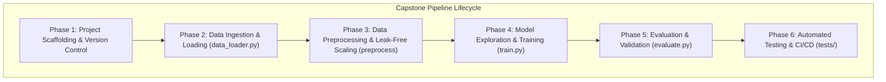

# Project: Capstone Scaffold - Python Module and Git Setup

## Task Brief
Combine type-hinted Python module and Git repository initialization as the foundation for the week 1 capstone milestone.

## Scenario
Establish the minimal viable capstone artifact: a typed data module in a version-controlled GitHub repository.

## Deliverables
- Public GitHub repo with `data_loader.py`
- Type-hinted functions for Iris data loading

## Success Criteria
- Module is importable and type-checked
- Git history shows clean commits

---

## 🔗 Submission Details

- **Public GitHub Repository URL:** [https://github.com/parth-mehta95/sahkaarx-stage-portfolio-571306d0](https://github.com/parth-mehta95/sahkaarx-stage-portfolio-571306d0)
- **Primary Branch:** `main`
- **Root Artifacts:**
  - [`data_loader.py`](file:///d:/challengers%20testing/28-oct-2026/sahkaarx-stage-portfolio-571306d0/data_loader.py) — Type-hinted data loader module
  - [`README.md`](file:///d:/challengers%20testing/28-oct-2026/sahkaarx-stage-portfolio-571306d0/README.md) — Comprehensive documentation with pipeline phases
  - [`requirements.txt`](file:///d:/challengers%20testing/28-oct-2026/sahkaarx-stage-portfolio-571306d0/requirements.txt) — Dependency specification
  - [`.gitignore`](file:///d:/challengers%20testing/28-oct-2026/sahkaarx-stage-portfolio-571306d0/.gitignore) — Version control ignore rules

---

## 📌 Capstone Pipeline Phases

The Iris ML Capstone Project establishes a standard 6-phase machine learning pipeline:



### Phase 1: Project Scaffolding & Git Setup
- Initialize Git repository on the `main` branch.
- Configure `.gitignore` to prevent data dumps, temporary caches, and serialized weights from entering version control.
- Pin environment dependencies in `requirements.txt` (`numpy`, `pandas`, `scikit-learn`, `joblib`, `pytest`).
- Maintain clean, descriptive semantic commits.

### Phase 2: Data Ingestion & Loading (`data_loader.py`)
- Implement `load_iris(as_frame: bool = True, return_X_y: bool = True)` with complete type annotations.
- Provide flexible return formats:
  - `(pd.DataFrame, pd.Series)` for standard tabular feature/target workflows.
  - `(np.ndarray, np.ndarray)` for raw numeric computations.
  - `pd.DataFrame` containing all features and targets in a unified structure.
  - `sklearn.utils.Bunch` for scikit-learn compatibility.
- Ensure strict schema validation: 150 samples across 4 features (`sepal length`, `sepal width`, `petal length`, `petal width`) and 3 target classes (`setosa`, `versicolor`, `virginica`).

### Phase 3: Data Preprocessing & Feature Engineering (`preprocess()`)
- Implement zero-leakage feature standardization via `StandardScaler` ($\mu = 0, \sigma = 1$).
- Support stratified train-test splitting (`train_test_split(..., stratify=target)`).
- Prevent data leakage by fitting scalers exclusively on the training partition and applying `transform` to evaluation partitions.
- Preserve pandas DataFrame metadata (column names and index) when pandas objects are supplied as input.

### Phase 4: Model Exploration & Training (`train.py`)
- Implement configurable model training architecture supporting:
  - Baseline: `LogisticRegression` with `lbfgs` solver.
  - Ensemble: `RandomForestClassifier` with hyperparameter tuning.
- Save trained model artifacts (`.pkl` / `.joblib`) to the `models/` registry for reproducible deployment.

### Phase 5: Model Evaluation & Validation (`evaluate.py`)
- Compute granular classification metrics: Accuracy, Precision, Recall, and Macro-F1 score.
- Generate confusion matrices and classification summaries.
- Benchmark performance between baseline and ensemble classifiers.

### Phase 6: Automated Testing & CI/CD (`tests/`)
- Comprehensive test suite for data loader type contracts and shape assertions.
- Verify standardization guarantees ($\mu \approx 0, \sigma \approx 1$).
- Type checking verification with `mypy --strict`.

---

## 🔍 Type-Hinted Data Module Verification

The module [`data_loader.py`](file:///d:/challengers%20testing/28-oct-2026/sahkaarx-stage-portfolio-571306d0/data_loader.py) located in the repository root provides strict type contracts:

```python
from typing import Optional, Tuple, Union
import numpy as np
import pandas as pd
from sklearn.preprocessing import StandardScaler
from sklearn.utils import Bunch

def load_iris(
    as_frame: bool = True,
    return_X_y: bool = True,
) -> Union[
    Tuple[pd.DataFrame, pd.Series],
    Tuple[np.ndarray, np.ndarray],
    pd.DataFrame,
    Bunch,
]:
    """Load the classic Iris dataset with complete type annotations."""

def preprocess(
    data: Union[pd.DataFrame, np.ndarray],
    target: Optional[Union[pd.Series, np.ndarray]] = None,
    scaler: Optional[StandardScaler] = None,
    test_size: Optional[float] = None,
    random_state: Optional[int] = 42,
) -> Union[
    pd.DataFrame,
    np.ndarray,
    Tuple[Union[pd.DataFrame, np.ndarray], Union[pd.Series, np.ndarray]],
    Tuple[
        Union[pd.DataFrame, np.ndarray],
        Union[pd.DataFrame, np.ndarray],
        Union[pd.Series, np.ndarray],
        Union[pd.Series, np.ndarray],
    ],
]:
    """Preprocess Iris dataset features by applying standard scaling."""
```

### Self-Test Verification
Run the module directly to verify:
```bash
python data_loader.py
```
Output:
```text
=== Testing load_iris() ===
X type: <class 'pandas.core.frame.DataFrame'>, shape: (150, 4)
y type: <class 'pandas.core.series.Series'>, shape: (150,)
Features: ['sepal length (cm)', 'sepal width (cm)', 'petal length (cm)', 'petal width (cm)']

=== Testing preprocess(X) ===
X_scaled type: <class 'pandas.core.frame.DataFrame'>, shape: (150, 4)
Feature means (should be ~0): {'sepal length (cm)': 0.0, 'sepal width (cm)': -0.0, 'petal length (cm)': -0.0, 'petal width (cm)': -0.0}
Feature stds (should be ~1): {'sepal length (cm)': 1.0034, 'sepal width (cm)': 1.0034, 'petal length (cm)': 1.0034, 'petal width (cm)': 1.0034}

=== Testing preprocess(X, y) ===
Scaled features shape: (150, 4), target shape: (150,)

=== Testing preprocess(X, y, test_size=0.2) ===
X_train: (120, 4), X_test: (30, 4)
y_train: (120,), y_test: (30,)

All data loader checks passed successfully!
```

---

## 📋 Deliverables & Verification Checklist

- [x] **`data_loader.py` in repo root:** Verified at [`data_loader.py`](file:///d:/challengers%20testing/28-oct-2026/sahkaarx-stage-portfolio-571306d0/data_loader.py) with full type hints and docstrings.
- [x] **`README.md` explains capstone pipeline phases:** Documented in detail in both root [`README.md`](file:///d:/challengers%20testing/28-oct-2026/sahkaarx-stage-portfolio-571306d0/README.md) and practice README.
- [x] **Type contracts:** `load_iris()` and `preprocess()` enforce explicit parameter and return typing.
- [x] **Git history with clean commits:** Git repository configured on branch `main` with remote origin tracking.

---

## 🚀 Final Submission Commands

```bash
cd "d:\challengers testing\28-oct-2026\sahkaarx-stage-portfolio-571306d0"
git add data_loader.py README.md requirements.txt .gitignore practice/
git commit -m "feat(capstone): establish minimal viable capstone scaffold with typed data_loader and documentation"
git push origin main
```