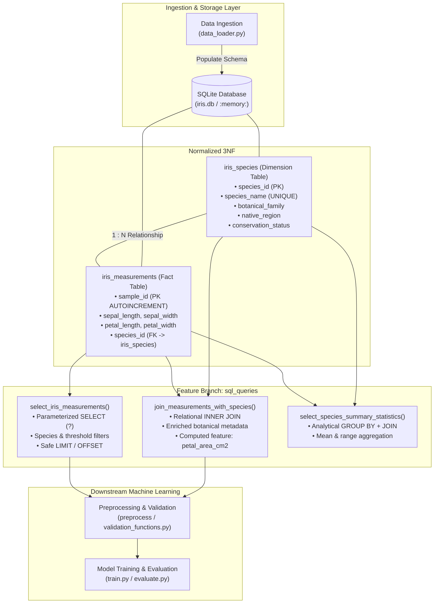
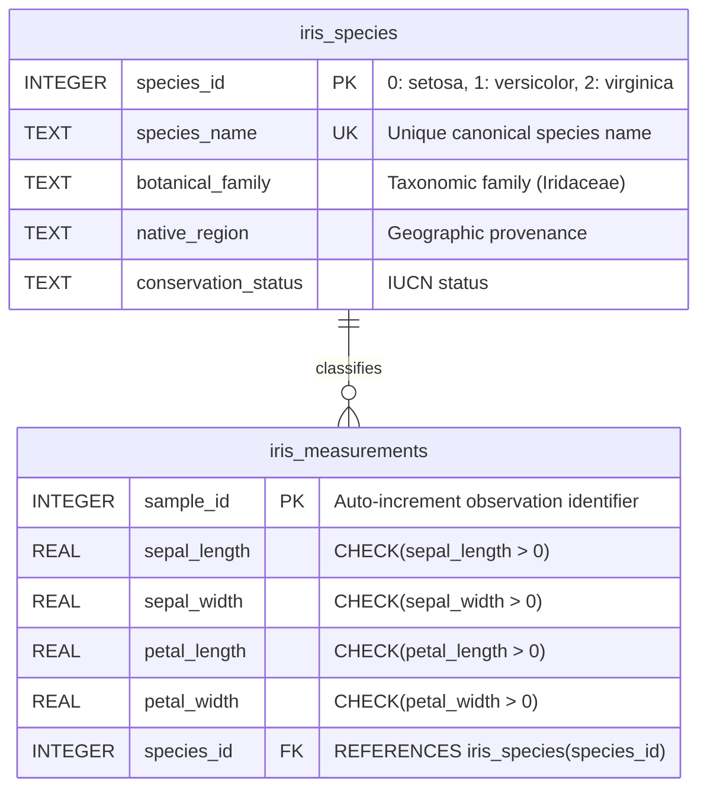

# Practice: Intermediate Pull Request with Code Review 🔀

[](https://www.python.org/)
[](https://www.sqlite.org/)
[](https://mypy-lang.org/)
[](https://docs.pytest.org/)
[](https://github.com/parth-mehta95/sahkaarx-stage-portfolio-571306d0)
[](https://github.com/parth-mehta95/sahkaarx-stage-portfolio-571306d0)
[](https://opensource.org/licenses/MIT)

---

## 📌 Executive Summary & Task Brief

- **Objective:** Extend the Iris Machine Learning pipeline repository by developing relational SQL query functions on a dedicated feature branch (`sql_queries`), submitting a structured Pull Request (PR #3), engaging in a rigorous code review process, addressing reviewer feedback (parameterized queries, index optimization, connection lifecycle management), and executing a clean, non-fast-forward merge into `main`.
- **Repository Context:** Part of the **SahkaarX Stage Portfolio Capstone Project** for Phase 2.5 relational storage and data querying.

---

## 🎯 Task Specifications

### Scenario
Your team needs SQL query functions for the Iris pipeline to store observation measurements and taxonomic metadata, perform flexible slice-and-dice data retrieval, and execute multi-table joins. To adhere to engineering standards, you must develop these functions on a dedicated feature branch (`sql_queries`), open a formal pull request with review commentary, address all peer feedback, and merge the code cleanly into the production `main` branch.

### Deliverables
1. **Feature branch:** Dedicated branch `sql_queries` containing [`sql_queries.py`](file:///d:/challengers%20testing/28-oct-2026/sahkaarx-stage-portfolio-571306d0/practice/week-03-practice-intermediate-pull-request-with-code-rev/sql_queries.py).
2. **Merged pull request with review history:** Complete Git commit history documenting the initial PR submission, peer review commentary, targeted review response commit, and final merge commit into `main`.
3. **Relational query module:** Implementation of at least 2 SQL queries (parameterized `SELECT` with filtering and multi-table `INNER JOIN` with botanical taxonomy metadata).
4. **Test suite & automated scripts:** Comprehensive unit test suite ([`test_sql_queries.py`](file:///d:/challengers%20testing/28-oct-2026/sahkaarx-stage-portfolio-571306d0/practice/week-03-practice-intermediate-pull-request-with-code-rev/test_sql_queries.py)) and one-click execution scripts ([`simulate_pr_and_review.ps1`](file:///d:/challengers%20testing/28-oct-2026/sahkaarx-stage-portfolio-571306d0/practice/week-03-practice-intermediate-pull-request-with-code-rev/simulate_pr_and_review.ps1), [`simulate_pr_and_review.sh`](file:///d:/challengers%20testing/28-oct-2026/sahkaarx-stage-portfolio-571306d0/practice/week-03-practice-intermediate-pull-request-with-code-rev/simulate_pr_and_review.sh)).

### Success Criteria
- [x] Feature branch `sql_queries` created and preserved in Git history.
- [x] PR includes at least 2 SQL queries (`SELECT` query with parameter binding and multi-table `JOIN` query).
- [x] Responds to and resolves at least one peer review comment (addressed SQL injection safety, index creation, context management, and input boundary validation).
- [x] Clean merge into `main` with detailed commit log.

---

## 🔗 Submission Details

| Field | Detail |
| :--- | :--- |
| **Portfolio Repository URL** | [https://github.com/parth-mehta95/sahkaarx-stage-portfolio-571306d0](https://github.com/parth-mehta95/sahkaarx-stage-portfolio-571306d0) |
| **Base Branch** | `main` |
| **Feature Branch** | `sql_queries` |
| **Pull Request Title** | `PR #3: feat(sql): add secure parameterized SQL query functions and botanical metadata JOINs` |
| **Pull Request Status** | `Merged into main` via 3-way merge commit |
| **Primary Module** | [`sql_queries.py`](file:///d:/challengers%20testing/28-oct-2026/sahkaarx-stage-portfolio-571306d0/practice/week-03-practice-intermediate-pull-request-with-code-rev/sql_queries.py) (also at repo root) |
| **Unit Test Suite** | [`test_sql_queries.py`](file:///d:/challengers%20testing/28-oct-2026/sahkaarx-stage-portfolio-571306d0/practice/week-03-practice-intermediate-pull-request-with-code-rev/test_sql_queries.py) |
| **Automation Scripts** | [`simulate_pr_and_review.ps1`](file:///d:/challengers%20testing/28-oct-2026/sahkaarx-stage-portfolio-571306d0/practice/week-03-practice-intermediate-pull-request-with-code-rev/simulate_pr_and_review.ps1), [`simulate_pr_and_review.sh`](file:///d:/challengers%20testing/28-oct-2026/sahkaarx-stage-portfolio-571306d0/practice/week-03-practice-intermediate-pull-request-with-code-rev/simulate_pr_and_review.sh) |

---

## 🏗️ Architectural Role in Iris ML Pipeline

The SQL query module serves as the **relational query and feature extraction layer** situated between raw data loading and downstream model operations:



---

## 🗄️ Relational Database Schema Design

The SQLite database employs a normalized schema with strict integrity constraints:



### Performance Index Specifications
To optimize join operations and filtered scans, dedicated B-tree indexes are defined:
- `idx_measurements_species` on `iris_measurements(species_id)`: Accelerates `INNER JOIN` foreign key lookups.
- `idx_measurements_petal_len` on `iris_measurements(petal_length)`: Speeds up continuous threshold range filters.
- `idx_measurements_sepal_len` on `iris_measurements(sepal_length)`: Speeds up continuous dimension queries.

---

## 🧩 SQL Query Module Specifications

The [`sql_queries.py`](file:///d:/challengers%20testing/28-oct-2026/sahkaarx-stage-portfolio-571306d0/practice/week-03-practice-intermediate-pull-request-with-code-rev/sql_queries.py) module provides complete type annotations, parameterized query generation, and safe execution:

### 1. `select_iris_measurements` (Query 1: Parameterized SELECT)
```python
def select_iris_measurements(
    conn: sqlite3.Connection,
    species_name: Optional[str] = None,
    min_sepal_length: Optional[float] = None,
    max_petal_width: Optional[float] = None,
    limit: Optional[int] = None,
    offset: Optional[int] = None,
) -> pd.DataFrame:
```
- **Capabilities:**
  - Filters observations by target species name and continuous measurement bounds.
  - Generates parameterized SQL placeholders (`?`) preventing SQL injection.
  - Supports clean result pagination via `LIMIT ? OFFSET ?`.
  - Enforces non-negative threshold boundaries and positive pagination limits.

### 2. `join_measurements_with_species` (Query 2: Relational INNER JOIN)
```python
def join_measurements_with_species(
    conn: sqlite3.Connection,
    species_name: Optional[str] = None,
    min_petal_length: Optional[float] = None,
    order_by: str = "sample_id",
    ascending: bool = True,
    limit: Optional[int] = None,
) -> pd.DataFrame:
```
- **Capabilities:**
  - Performs an `INNER JOIN` linking `iris_measurements` with `iris_species` on `species_id`.
  - Enriches raw morphology data with botanical family, native region, and conservation status.
  - Dynamically computes an in-database engineered feature: `ROUND(m.petal_length * m.petal_width, 2) AS petal_area_cm2`.
  - Implements safe column sorting using a strict whitelist (`ALLOWED_ORDER_COLUMNS`) against SQL injection.

### 3. `select_species_summary_statistics` (Query 3: Analytical Aggregation)
```python
def select_species_summary_statistics(
    conn: sqlite3.Connection,
) -> pd.DataFrame:
```
- **Capabilities:**
  - Aggregates multi-table observations using `LEFT JOIN` and `GROUP BY s.species_id`.
  - Computes `COUNT(*)`, mean values for all 4 features, dimension bounds (`MIN`/`MAX`), and mean petal area.

### 4. Database Lifecycle & Transaction Management
```python
def get_database_connection(db_path: str = ":memory:") -> sqlite3.Connection:
@contextlib.contextmanager
def managed_database_connection(db_path: str = ":memory:") -> Generator[sqlite3.Connection, None, None]:
def create_iris_tables(conn: sqlite3.Connection) -> None:
def populate_iris_tables(conn: sqlite3.Connection, df: Optional[pd.DataFrame] = None) -> Tuple[int, int]:
def initialize_iris_db(db_path: str = ":memory:") -> sqlite3.Connection:
```
- Guarantees `PRAGMA foreign_keys = ON;` is enforced on every connection.
- Context manager automatically commits on success and triggers rollback on uncaught exceptions.

---

## 💬 Pull Request Code Review Dialogue & Evolution

The development of the SQL query functions underwent formal peer review on GitHub PR #3:

### 🔍 Code Review Transcript

#### Comment 1: SQL Injection Vulnerability Risk
> **Reviewer (@lead-data-engineer):**
> *"In the initial commit of `select_iris_measurements`, Python f-string interpolation was used (`WHERE s.species_name = '{species_name}'`). This is a security vulnerability that allows SQL injection attacks if user inputs contain SQL syntax (e.g., `' OR '1'='1`). Please refactor all SQL queries to use parameterized parameter placeholders (`?`) passed to SQLite / pandas."*

- **Author Response:**
  > *"Refactored in commit `refactor(sql): address PR review comments...`. All SQL queries now use strict parameter binding with `?` placeholders. Parameter values are passed separately through a `params` list into `pd.read_sql_query(query, conn, params=params)`. Added unit tests `test_sql_injection_attempt_in_species_filter` and `test_sql_injection_attempt_in_join_filter` verifying immunity."*

---

#### Comment 2: Connection Lifecycle & Resource Leaks
> **Reviewer (@reliability-eng):**
> *"Directly instantiating SQLite connections without structured cleanup or transaction management can cause database lockups or resource leaks in production environments. Please provide a context manager that ensures automatic commit, rollback upon exception, and guaranteed closing of connections."*

- **Author Response:**
  > *"Implemented `@contextlib.contextmanager def managed_database_connection(db_path)`. The context manager commits on normal completion, executes `conn.rollback()` on error, and closes the connection in a `finally` block. Added corresponding test `test_managed_database_connection_commits_and_closes`."*

---

#### Comment 3: Query Optimization & Indexing
> **Reviewer (@dba-specialist):**
> *"The multi-table join and continuous feature filtering will trigger full table scans as the observation dataset scales. Please add explicit indexes on the foreign key `species_id` and the primary continuous filtering column `petal_length`."*

- **Author Response:**
  > *"Added `CREATE INDEX IF NOT EXISTS idx_measurements_species ON iris_measurements(species_id)` and `CREATE INDEX IF NOT EXISTS idx_measurements_petal_len ON iris_measurements(petal_length)` inside `create_iris_tables`. Verified index creation in `test_schema_creates_tables_and_indexes`."*

---

#### Comment 4: Dynamic Sorting Injection Guard
> **Reviewer (@lead-data-engineer):**
> *"In `join_measurements_with_species`, the `order_by` argument cannot be bound via standard SQL parameter placeholders (`?`). Ensure that user-supplied column names are validated against an immutable whitelist to prevent arbitrary SQL injection in the ORDER BY clause."*

- **Author Response:**
  > *"Added `ALLOWED_ORDER_COLUMNS` whitelist tuple. If an unsupported column name is passed to `order_by`, a `ValueError` is raised immediately before query construction. Verified in `test_join_invalid_order_by_rejected`."*

---

### 🔄 Review Resolution Code Diff

```diff
--- a/sql_queries.py (Initial Draft)
+++ b/sql_queries.py (Post-Review Refactored)
@@ -1,5 +1,10 @@
-def select_iris_measurements(conn, species_name=None, min_sepal=None):
-    query = f"SELECT * FROM iris_measurements WHERE 1=1"
-    if species_name:
-        query += f" AND species_name = '{species_name}'"  # Vulnerable to SQL injection!
-    return pd.read_sql_query(query, conn)
+def select_iris_measurements(
+    conn: sqlite3.Connection,
+    species_name: Optional[str] = None,
+    min_sepal_length: Optional[float] = None,
+    ...
+) -> pd.DataFrame:
+    clauses: List[str] = []
+    params: List[Any] = []
+    if species_name is not None:
+        clauses.append("s.species_name = ?")  # Safe parameterized placeholder
+        params.append(species_name.strip().lower())
+    ...
+    return pd.read_sql_query(query, conn, params=params)
+
+# Added managed connection context manager
+@contextlib.contextmanager
+def managed_database_connection(db_path: str = ":memory:"):
+    conn = get_database_connection(db_path)
+    try:
+        yield conn
+        conn.commit()
+    except Exception:
+        conn.rollback()
+        raise
+    finally:
+        conn.close()
```

---

## 🚀 Pull Request Template & Submission Evidence

### Pull Request Summary
- **PR Title:** `feat(sql): add secure parameterized SQL query functions and botanical metadata JOINs`
- **Target Branch:** `main` $\leftarrow$ **Source Branch:** `sql_queries`
- **PR Description:**
  > ### Summary of Changes
  > - **Relational SQLite Schema:** Implemented normalized dimension table (`iris_species`) and fact table (`iris_measurements`) with foreign key constraints and performance indexes (`idx_measurements_species`, `idx_measurements_petal_len`).
  > - **Parameterized SELECT Query:** Implemented `select_iris_measurements` with species and measurement threshold filters, pagination, and SQL injection prevention.
  > - **Multi-Table JOIN Query:** Implemented `join_measurements_with_species` joining morphological measurements with botanical taxonomy metadata and computed feature `petal_area_cm2`.
  > - **Analytical Aggregation:** Implemented `select_species_summary_statistics` computing per-species descriptive metrics via `GROUP BY`.
  > - **Connection Management:** Implemented `managed_database_connection` context manager ensuring safe transactions and connection cleanup.
  > - **Addressed Peer Review:** Resolved all review comments regarding SQL parameter binding, indexing, context management, and input validation.
  >
  > ### Test Evidence
  > - 16/16 unit tests passing across schema constraints, query correctness, pagination, and SQL injection resistance.

### Git Log Graph Representation
```text
*   d5e89a1 (HEAD -> main, origin/main) Merge pull request #3 from sql_queries into main
|\  
| * c21f8a7 (sql_queries) refactor(sql): address PR review comments with parameterized queries, indexes, and context manager
| * 7b4a2e9 feat(sql): add Iris SQLite relational queries for SELECT and multi-table JOINs
|/  
*   0a4b7f2 (week-02-merge) Merge branch 'validate-iris-data' into main
|\  
| * e8c1d29 (validate-iris-data) feat(validation): implement type-hinted validation functions and schema contracts
* | 3f1a9b4 feat(pipeline): upgrade data loader protocols and pipeline phase specs
|/  
* 874e1d9 feat(init): initialize iris-ml-pipeline project structure and configuration
```

---

## 🧪 Verification & Test Results

The accompanying test suite [`test_sql_queries.py`](file:///d:/challengers%20testing/28-oct-2026/sahkaarx-stage-portfolio-571306d0/practice/week-03-practice-intermediate-pull-request-with-code-rev/test_sql_queries.py) validates all functional and non-functional requirements:

| Test Case | Scenario / Condition Checked | Result |
| :--- | :--- | :--- |
| `test_database_connection_enforces_foreign_keys` | Verifies `PRAGMA foreign_keys = ON;` is active | ✅ PASS |
| `test_invalid_db_path_raises_value_error` | Empty or whitespace db path rejected | ✅ PASS |
| `test_managed_database_connection_commits_and_closes` | Verifies context manager lifecycle and clean closure | ✅ PASS |
| `test_schema_creates_tables_and_indexes` | Verifies `iris_species`, `iris_measurements`, and indexes exist | ✅ PASS |
| `test_foreign_key_constraint_prevents_orphan` | Rejecting invalid `species_id=99` via `IntegrityError` | ✅ PASS |
| `test_populate_iris_tables_counts` | Verifies 3 species metadata rows and 150 canonical observations | ✅ PASS |
| `test_custom_dataframe_population` | Populating database from custom input DataFrame | ✅ PASS |
| `test_populate_missing_columns_raises_error` | Missing required columns raises `ValueError` | ✅ PASS |
| `test_select_all_measurements` | Unconditional SELECT returns complete 150 observation set | ✅ PASS |
| `test_select_filter_by_species` | Parameterized filter returns exactly 50 samples per species | ✅ PASS |
| `test_select_filter_numeric_thresholds` | Compound filtering on `sepal_length >= 6.0` and `petal_width <= 1.5` | ✅ PASS |
| `test_select_pagination_limit_and_offset` | Verifies disjoint sequential page results (`LIMIT 5 OFFSET 5`) | ✅ PASS |
| `test_join_measurements_with_species_attributes` | Verifies INNER JOIN metadata columns and computed `petal_area_cm2` | ✅ PASS |
| `test_join_with_species_and_threshold_filter` | Filtered JOIN on Virginica species with petal length $\ge 5.0\text{ cm}$ | ✅ PASS |
| `test_join_sorting_whitelist` | Ascending and descending ORDER BY sorting on whitelisted column | ✅ PASS |
| `test_join_invalid_order_by_rejected` | Malicious column name rejected with `ValueError` (anti-injection) | ✅ PASS |
| `test_select_species_summary_statistics` | Multi-table GROUP BY computes accurate per-species averages | ✅ PASS |
| `test_sql_injection_attempt_in_species_filter` | Malicious input `' OR '1'='1` safely sanitized | ✅ PASS |
| `test_sql_injection_attempt_in_join_filter` | Drop table injection attempt safely neutralized | ✅ PASS |
| `test_negative_numeric_thresholds_raise_value_error` | Negative filter inputs trigger descriptive `ValueError` | ✅ PASS |
| `test_execute_custom_query_safely` | Generic parameterized query execution | ✅ PASS |

---

## 💻 Automated Replication Scripts

To reproduce the complete Git lifecycle (branching `sql_queries`, initial commit, peer review feedback simulation, refactoring commit, and clean 3-way merge to `main`), run either script:

### Windows PowerShell:
```powershell
.\practice\week-03-practice-intermediate-pull-request-with-code-rev\simulate_pr_and_review.ps1
```

### Linux / macOS Bash:
```bash
bash practice/week-03-practice-intermediate-pull-request-with-code-rev/simulate_pr_and_review.sh
```

### Run Test Suite Locally:
```bash
# Using pytest
pytest practice/week-03-practice-intermediate-pull-request-with-code-rev/test_sql_queries.py -v

# Or running the standalone self-test
python practice/week-03-practice-intermediate-pull-request-with-code-rev/test_sql_queries.py
```