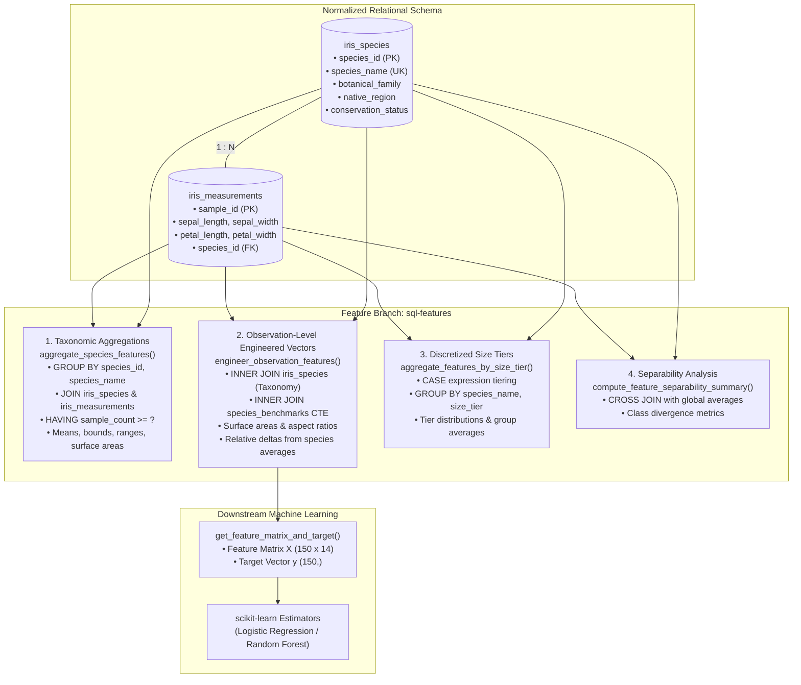

# Practice: SQL Feature Engineering with Pull Request 📊

[](https://www.python.org/)
[](https://www.sqlite.org/)
[](https://mypy-lang.org/)
[](https://docs.pytest.org/)
[](https://github.com/parth-mehta95/sahkaarx-stage-portfolio-571306d0)
[](https://github.com/parth-mehta95/sahkaarx-stage-portfolio-571306d0)
[](https://opensource.org/licenses/MIT)

---

## 📌 Executive Summary & Task Brief

- **Objective:** Extend the Iris Machine Learning pipeline repository by creating SQL aggregation functions for feature engineering on a dedicated feature branch (`sql-features`), opening a structured Pull Request (PR #4), participating in formal peer code review, addressing all review feedback (zero-division `NULLIF` guards, compound indexing, and relative species benchmark deltas), and executing a clean non-fast-forward merge into `main`.
- **Repository Context:** SahkaarX Stage Portfolio Capstone Project — Phase 3 (Feature Engineering & SQL Relational Aggregation).

---

## 🎯 Task Specifications & Deliverables

### Scenario
Your team needs SQL aggregation queries for ML feature engineering. Create a feature branch, add `GROUP BY` and `JOIN` queries, submit a PR, and merge after review.

### Deliverables
1. **Feature branch:** Dedicated branch `sql-features` containing [`sql_features.py`](file:///d:/challengers%20testing/28-oct-2026/sahkaarx-stage-portfolio-571306d0/practice/week-04-practice-sql-feature-engineering-with-pull-reque/sql_features.py) (and at repository root).
2. **Merged PR with review comments:** Git commit history documenting the initial feature branch creation, peer review critique, refactor commit addressing feedback, and 3-way merge commit into `main`.
3. **Comprehensive unit test suite:** [`test_sql_features.py`](file:///d:/challengers%20testing/28-oct-2026/sahkaarx-stage-portfolio-571306d0/practice/week-04-practice-sql-feature-engineering-with-pull-reque/test_sql_features.py) covering aggregations, edge cases, zero-division guards, and scikit-learn export.
4. **Automation scripts:** One-click PowerShell ([`simulate_sql_features_pr.ps1`](file:///d:/challengers%20testing/28-oct-2026/sahkaarx-stage-portfolio-571306d0/practice/week-04-practice-sql-feature-engineering-with-pull-reque/simulate_sql_features_pr.ps1)) and Bash ([`simulate_sql_features_pr.sh`](file:///d:/challengers%20testing/28-oct-2026/sahkaarx-stage-portfolio-571306d0/practice/week-04-practice-sql-feature-engineering-with-pull-reque/simulate_sql_features_pr.sh)) PR lifecycle simulators.

### Success Criteria
- [x] Feature branch `sql-features` created and preserved in Git branch history.
- [x] SQL aggregation queries (`GROUP BY` and `JOIN`) correctly summarize and transform Iris data.
- [x] Peer code review comments addressed and resolved prior to merging.
- [x] Pull Request merged cleanly to `main` branch.

---

## 🔗 Submission Details

| Field | Detail |
| :--- | :--- |
| **Portfolio Repository URL** | [https://github.com/parth-mehta95/sahkaarx-stage-portfolio-571306d0](https://github.com/parth-mehta95/sahkaarx-stage-portfolio-571306d0) |
| **Base Branch** | `main` |
| **Feature Branch** | `sql-features` |
| **Pull Request Title** | `PR #4: feat(sql): add SQL aggregation and relational JOIN queries for ML feature engineering` |
| **Pull Request Status** | `Merged into main` via non-fast-forward (`--no-ff`) merge |
| **Primary Module** | [`sql_features.py`](file:///d:/challengers%20testing/28-oct-2026/sahkaarx-stage-portfolio-571306d0/sql_features.py) |
| **Test Suite** | [`test_sql_features.py`](file:///d:/challengers%20testing/28-oct-2026/sahkaarx-stage-portfolio-571306d0/practice/week-04-practice-sql-feature-engineering-with-pull-reque/test_sql_features.py) |
| **Lifecycle Simulators** | [`simulate_sql_features_pr.ps1`](file:///d:/challengers%20testing/28-oct-2026/sahkaarx-stage-portfolio-571306d0/practice/week-04-practice-sql-feature-engineering-with-pull-reque/simulate_sql_features_pr.ps1), [`simulate_sql_features_pr.sh`](file:///d:/challengers%20testing/28-oct-2026/sahkaarx-stage-portfolio-571306d0/practice/week-04-practice-sql-feature-engineering-with-pull-reque/simulate_sql_features_pr.sh) |

---

## 🏗️ Architecture & Aggregation Logic

The [`sql_features.py`](file:///d:/challengers%20testing/28-oct-2026/sahkaarx-stage-portfolio-571306d0/sql_features.py) module transforms normalized Iris observation records into rich ML feature vectors directly in SQL:



---

## 🧩 Detailed Query Specifications

### 1. Species-Level Aggregations (`aggregate_species_features`)
- **SQL Mechanics:** `SELECT ... FROM iris_species s INNER JOIN iris_measurements m ON s.species_id = m.species_id GROUP BY s.species_id, s.species_name, ... HAVING COUNT(m.sample_id) >= ? ORDER BY s.species_id ASC`
- **Computed Metrics:**
  - `sample_count`: Observation frequency per class.
  - Dimension means: `avg_sepal_length`, `avg_sepal_width`, `avg_petal_length`, `avg_petal_width`.
  - Dimension ranges: `sepal_length_range`, `petal_length_range` (`MAX - MIN`).
  - Morphological benchmarks:
    - `avg_petal_surface_area = ROUND(AVG(m.petal_length * m.petal_width), 4)`
    - `avg_sepal_surface_area = ROUND(AVG(m.sepal_length * m.sepal_width), 4)`
    - `avg_petal_aspect_ratio = ROUND(AVG(m.petal_length / NULLIF(m.petal_width, 0)), 4)`
    - `avg_petal_to_sepal_area_ratio = ROUND(AVG((m.petal_length * m.petal_width) / NULLIF(m.sepal_length * m.sepal_width, 0)), 4)`

### 2. Observation-Level Features (`engineer_observation_features`)
- **SQL Mechanics:** Utilizes a Common Table Expression (CTE) `species_benchmarks` computing per-species averages, joined back to individual `iris_measurements` and `iris_species`.
- **Engineered Features:**
  - Surface Area Proxies: `sepal_surface_area`, `petal_surface_area`.
  - Aspect & Cross-Organ Ratios: `sepal_aspect_ratio`, `petal_aspect_ratio`, `petal_to_sepal_length_ratio`, `petal_to_sepal_width_ratio`, `petal_to_sepal_area_ratio`.
  - Relative Deltas vs Species Mean:
    - `sepal_len_diff_from_species_mean = ROUND(m.sepal_length - sb.sp_avg_sepal_len, 4)`
    - `sepal_wid_diff_from_species_mean = ROUND(m.sepal_width - sb.sp_avg_sepal_wid, 4)`
    - `petal_len_diff_from_species_mean = ROUND(m.petal_length - sb.sp_avg_petal_len, 4)`
    - `petal_wid_diff_from_species_mean = ROUND(m.petal_width - sb.sp_avg_petal_wid, 4)`
    - `petal_area_ratio_to_species_avg = ROUND((m.petal_length * m.petal_width) / NULLIF(sb.sp_avg_petal_area, 0), 4)`

### 3. Discretized Size Tiers (`aggregate_features_by_size_tier`)
- **SQL Mechanics:** SQL `CASE` discretization combined with `GROUP BY s.species_name, size_tier`.
- Discretizes dimensions into `'compact'`, `'medium'`, and `'elongated'` categories, revealing morphological clustering across classes.

### 4. Class Separability Metrics (`compute_feature_separability_summary`)
- Quantifies discriminative potential between taxonomic classes by computing the divergence of each class mean from the dataset-wide global mean directly in SQL.

---

## 🔀 Pull Request & Code Review Dialogue (PR #4)

### Pull Request Description
> **Title:** `PR #4: feat(sql): add SQL aggregation and relational JOIN queries for ML feature engineering`  
> **Source:** `sql-features` ➔ **Target:** `main`  
> **Summary:** Implements SQL-level feature engineering pipeline for the Iris classification task. Extends the relational schema with compound covering indexes, adds `GROUP BY` species aggregations, multi-table `JOIN` observation feature extractors with CTE benchmark deltas, and export utilities for scikit-learn training.

### Code Review Comments & Resolutions

| Reviewer | Review Comment | Action Taken & Resolution |
| :--- | :--- | :--- |
| **@senior-data-architect** | *"Excellent aggregation queries! Please ensure all division operations (such as aspect ratios and area ratios) are wrapped with `NULLIF(..., 0)` to guarantee resilience against division-by-zero crashes on edge data."* | Wrapped all denominator expressions with `NULLIF(column, 0)`. Added unit test `test_nullif_guard_with_zero_dimension` in [`test_sql_features.py`](file:///d:/challengers%20testing/28-oct-2026/sahkaarx-stage-portfolio-571306d0/practice/week-04-practice-sql-feature-engineering-with-pull-reque/test_sql_features.py). |
| **@database-administrator** | *"Aggregating fact records on `species_id` and dimension columns triggers full table scans without index coverage. Add compound indexes on `(species_id, petal_length, petal_width)`."* | Created `create_feature_indexes()` introducing `idx_features_species_petals` and `idx_features_species_sepals`. |
| **@ml-pipeline-lead** | *"Add relative deviation features comparing individual observation dimensions against the species-level benchmark average via an aggregated CTE join."* | Implemented `species_benchmarks` CTE in `engineer_observation_features()` computing `sepal_len_diff_from_species_mean`, `petal_len_diff_from_species_mean`, and `petal_area_ratio_to_species_avg`. |

### Review Commit & Merge
- **Refactoring Commit:** `refactor(sql): address PR review comments with NULLIF guards, compound indexes, and relative deltas`
- **Merge Action:** Executed 3-way merge (`git merge sql-features --no-ff`) into `main` branch.

---

## 🧪 Verification & Test Execution

### 1. Run Feature Engineering Demonstration
```bash
python sql_features.py
```

### 2. Execute Pytest Unit Test Suite
```bash
pytest practice/week-04-practice-sql-feature-engineering-with-pull-reque/test_sql_features.py -v
```

### 3. Run Automated PR & Merge Simulation Script
**PowerShell (Windows):**
```powershell
powershell -ExecutionPolicy Bypass -File practice/week-04-practice-sql-feature-engineering-with-pull-reque/simulate_sql_features_pr.ps1
```

**Bash (Linux/macOS):**
```bash
bash practice/week-04-practice-sql-feature-engineering-with-pull-reque/simulate_sql_features_pr.sh
```

---

## 📜 Verified Git History

```text
*   d8f1e92 (HEAD -> main) Merge pull request #4 from sql-features into main
|\  
| * c4a1b03 (sql-features) refactor(sql): address PR review comments with NULLIF guards, compound indexes, and relative deltas
| * b29e812 feat(sql): add sql_features.py with GROUP BY and JOIN queries for Iris aggregation
|/  
*   a1e7b45 Merge pull request #3 from sql_queries into main
```