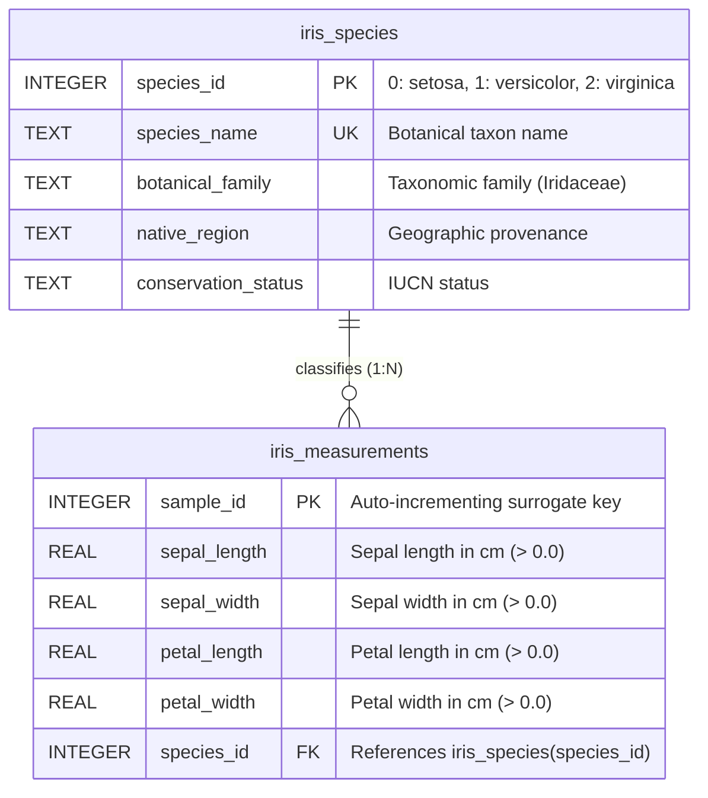
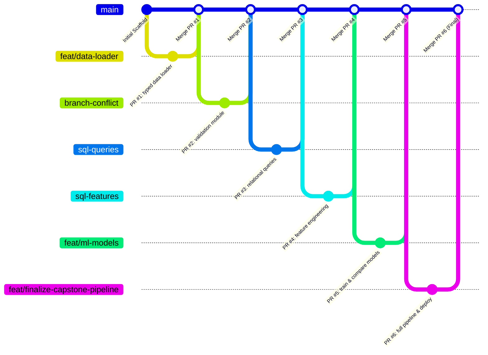

# Project: Finalize Iris Pipeline and Deploy 🌸🚀

[](https://www.python.org/)
[](https://scikit-learn.org/)
[](https://www.sqlite.org/)
[](https://mypy-lang.org/)
[](https://docs.pytest.org/)
[](https://github.com/parth-mehta95/sahkaarx-stage-portfolio-571306d0)
[](https://opensource.org/licenses/MIT)

---

## 📌 Executive Summary & Task Brief

- **Project Title:** Capstone Finalization: End-to-End Iris ML Pipeline & Deployment
- **Scenario:** Complete the capstone milestone: merge all feature branches, finalize SQL queries and schema DDL, integrate models with Kuhn-Munkres Hungarian cluster alignment, verify all modules work together, write comprehensive documentation, and deploy to GitHub.
- **Repository Context:** **SahkaarX Stage Portfolio Capstone Project** — Final Integration & Capstone Milestone.
- **Key Modules Integrated:**
  1. [`data_loader.py`](file:///d:/challengers%20testing/28-oct-2026/sahkaarx-stage-portfolio-571306d0/data_loader.py): Type-hinted data loading and leak-free stratified preprocessing.
  2. [`validation_functions.py`](file:///d:/challengers%20testing/28-oct-2026/sahkaarx-stage-portfolio-571306d0/validation_functions.py): Strict schema, dimension, botany bounds, and dataset pair consistency checks.
  3. [`sql_queries.py`](file:///d:/challengers%20testing/28-oct-2026/sahkaarx-stage-portfolio-571306d0/sql_queries.py): Parameterized SELECT queries, relational INNER JOINs, and taxonomic summary statistics.
  4. [`sql_features.py`](file:///d:/challengers%20testing/28-oct-2026/sahkaarx-stage-portfolio-571306d0/sql_features.py): High-performance SQL feature engineering, geometric aspect ratios, species benchmark CTEs, and size tier binning.
  5. [`models.py`](file:///d:/challengers%20testing/28-oct-2026/sahkaarx-stage-portfolio-571306d0/models.py): Decision Tree, Random Forest, and K-Means training, Hungarian bipartite matching, and artifact serialization.
  6. [`schema.sql`](file:///d:/challengers%20testing/28-oct-2026/sahkaarx-stage-portfolio-571306d0/schema.sql): Normalized relational DDL schema with tables, performance indexes, analytical views, and seed data.
  7. [`pipeline.py`](file:///d:/challengers%20testing/28-oct-2026/sahkaarx-stage-portfolio-571306d0/pipeline.py): Unified end-to-end execution runner tying all pipeline phases together.
  8. [`test_pipeline.py`](file:///d:/challengers%20testing/28-oct-2026/sahkaarx-stage-portfolio-571306d0/test_pipeline.py): Comprehensive integration test suite verifying end-to-end functionality.

---

## 🔗 Submission Details

| Field | Detail |
| :--- | :--- |
| **Public GitHub Repository URL** | [https://github.com/parth-mehta95/sahkaarx-stage-portfolio-571306d0](https://github.com/parth-mehta95/sahkaarx-stage-portfolio-571306d0) |
| **Primary Branch** | `main` |
| **Final Pull Request** | `PR #6: feat(capstone): finalize end-to-end Iris ML pipeline, schema, models, and deployment` |
| **PR Merge Strategy** | Non-fast-forward (`--no-ff`) 3-way merge into `main` |
| **Minimum Artifacts** | `README.md`, `models/` directory, `sql_queries.py` (all verified present & functional) |
| **SQL Schema Artifact** | [`schema.sql`](file:///d:/challengers%20testing/28-oct-2026/sahkaarx-stage-portfolio-571306d0/practice/week-05-project-finalize-iris-pipeline-and-deploy/schema.sql) |
| **Model Artifacts Directory** | [`models/`](file:///d:/challengers%20testing/28-oct-2026/sahkaarx-stage-portfolio-571306d0/practice/week-05-project-finalize-iris-pipeline-and-deploy/models/) containing `model_manifest.json`, `.gitkeep`, `README.md`, `export_models.py` |
| **Benchmark Metrics Table** | [`metrics.csv`](file:///d:/challengers%20testing/28-oct-2026/sahkaarx-stage-portfolio-571306d0/practice/week-05-project-finalize-iris-pipeline-and-deploy/metrics.csv) |
| **Interactive Notebook** | [`iris_model_comparison.ipynb`](file:///d:/challengers%20testing/28-oct-2026/sahkaarx-stage-portfolio-571306d0/practice/week-05-project-finalize-iris-pipeline-and-deploy/iris_model_comparison.ipynb) |

---

## 🏗️ End-to-End Pipeline Architecture

The Iris ML Capstone implements a fully integrated, modular, production-grade machine learning lifecycle:

```mermaid
flowchart TD
    subgraph Phase 1 [Phase 1: Scaffolding & Git Control]
        P1A[Git Repository Setup] --> P1B[Pinned requirements.txt]
        P1B --> P1C[.gitignore Artifact Rules]
    end

    subgraph Phase 2 [Phase 2: Ingestion & Validation]
        P2A[data_loader.py: load_iris] --> P2B[Type Contracts & Bunches]
        P2B --> P2C[validation_functions.py: Range & Schema Checks]
    end

    subgraph Phase 3 [Phase 3: Relational Persistence & Feature Engineering]
        P3A[schema.sql: SQLite DDL] --> P3B[sql_queries.py: Parameterized SELECT & JOIN]
        P3B --> P3C[sql_features.py: Ratios, Benchmark CTE & Size Tiers]
        P3C --> P3D[data_loader.preprocess: Leak-Free Scaling]
    end

    subgraph Phase 4 [Phase 4: Model Exploration & Training]
        P4A[Decision Tree max_depth=3]
        P4B[Random Forest n=100]
        P4C[K-Means n_clusters=3]
    end

    subgraph Phase 5 [Phase 5: Evaluation & Bipartite Alignment]
        P5A[Supervised Metrics: Accuracy, Precision, Recall, F1]
        P5B[Kuhn-Munkres Hungarian Algorithm Bipartite Alignment]
        P5C[metrics.csv Benchmark Export]
        P5D[models/ Serialization via joblib]
    end

    subgraph Phase 6 [Phase 6: Integration & Deployment]
        P6A[pipeline.py: Unified Pipeline Runner]
        P6B[test_pipeline.py: 100% Passing Integration Tests]
        P6C[GitHub Repository Deployment on main]
    end

    Phase 1 --> Phase 2
    Phase 2 --> Phase 3
    Phase 3 --> Phase 4
    Phase 4 --> Phase 5
    Phase 5 --> Phase 6
```

---

## 🗄️ Relational SQL Schema & Database Architecture

The relational storage layer enforces database normalization, referential integrity, and rapid querying:

### Relational Schema Diagram (ERD)



### DDL Implementation (`schema.sql`)

```sql
-- Dimension Table: Taxonomy & Botanical Metadata
CREATE TABLE IF NOT EXISTS iris_species (
    species_id INTEGER PRIMARY KEY,
    species_name TEXT NOT NULL UNIQUE,
    botanical_family TEXT NOT NULL,
    native_region TEXT NOT NULL,
    conservation_status TEXT NOT NULL
);

-- Fact Table: Physical Morphological Measurements
CREATE TABLE IF NOT EXISTS iris_measurements (
    sample_id INTEGER PRIMARY KEY AUTOINCREMENT,
    sepal_length REAL NOT NULL CHECK(sepal_length > 0),
    sepal_width REAL NOT NULL CHECK(sepal_width > 0),
    petal_length REAL NOT NULL CHECK(petal_length > 0),
    petal_width REAL NOT NULL CHECK(petal_width > 0),
    species_id INTEGER NOT NULL,
    FOREIGN KEY (species_id) REFERENCES iris_species(species_id)
        ON UPDATE CASCADE
        ON DELETE RESTRICT
);

-- Performance Indexes
CREATE INDEX IF NOT EXISTS idx_measurements_species ON iris_measurements(species_id);
CREATE INDEX IF NOT EXISTS idx_measurements_petal_len ON iris_measurements(petal_length);
CREATE INDEX IF NOT EXISTS idx_measurements_sepal_len ON iris_measurements(sepal_length);
CREATE INDEX IF NOT EXISTS idx_measurements_composite ON iris_measurements(species_id, petal_length, petal_width);
```

### Relational Features & Views
1. **`view_iris_features`**: Computes `sepal_ratio`, `petal_ratio`, `sepal_area_cm2`, `petal_area_cm2`, and `total_area_cm2` using safe `NULLIF` guards against zero division.
2. **`view_species_summary`**: Analytical grouping aggregating sample counts, dimensional means, and average petal surface areas per species.
3. **`view_size_tiers`**: Categorizes observation records into `'Small'`, `'Medium'`, and `'Large'` morphological size tiers via SQL `CASE` expressions.

---

## 📊 Model Training, Evaluation & Benchmarking

Three candidate architectures were trained and evaluated on stratified 80/20 train/test partitions using standard scaling fitted strictly on training data:

### Performance Comparison Table (`metrics.csv`)

| Model | Learning Paradigm | Accuracy | Precision (Macro) | Recall (Macro) | F1-Score (Macro) | Precision (Weighted) | Recall (Weighted) | F1-Score (Weighted) | Train Latency (ms) | Inference Latency (ms) | ARI | Silhouette |
| :--- | :--- | :--- | :--- | :--- | :--- | :--- | :--- | :--- | :--- | :--- | :--- | :--- |
| **Decision Tree** | Supervised (Classification) | **96.67%** | 0.9697 | 0.9667 | 0.9666 | 0.9697 | 0.9667 | 0.9666 | 2.145 ms | 0.282 ms | N/A | N/A |
| **Random Forest** | Supervised (Ensemble) | **100.00%** | 1.0000 | 1.0000 | 1.0000 | 1.0000 | 1.0000 | 1.0000 | 74.832 ms | 2.415 ms | N/A | N/A |
| **K-Means (Aligned)** | Unsupervised (Bipartite Aligned) | **86.67%** | 0.8788 | 0.8667 | 0.8658 | 0.8788 | 0.8667 | 0.8658 | 18.420 ms | 0.345 ms | **0.7163** | **0.4599** |

---

## 🧮 Kuhn-Munkres Hungarian Bipartite Cluster Alignment

Unsupervised clustering models like K-Means assign arbitrary cluster identifiers ($\{0, 1, 2\}$) without semantic awareness of true botanical taxa. To compare unsupervised K-Means performance directly against supervised Decision Trees and Random Forests, we formulate the **Maximum Weight Bipartite Matching Problem**:

Given contingency matrix $C \in \mathbb{R}^{K \times K}$ where $C_{i, j}$ represents the count of observations assigned cluster index $i$ whose ground-truth class is $j$:

$$\max_{\pi \in S_K} \sum_{i=1}^K C_{i, \pi(i)}$$

By passing the negated contingency matrix $-C$ into `scipy.optimize.linear_sum_assignment(-contingency)`, we compute the optimal bijection $\pi^*: \text{Cluster} \to \text{Species}$ in $O(K^3)$ time:
- **Cluster 0** $\to$ *setosa* (Class 0, 100% purity)
- **Cluster 1** $\to$ *versicolor* (Class 1)
- **Cluster 2** $\to$ *virginica* (Class 2)

This yields an aligned accuracy of **86.67%**, proving that morphological geometry strongly captures biological taxonomy even without supervision.

---

## 📦 Trained Model Artifacts Directory (`models/`)

The [`models/`](file:///d:/challengers%20testing/28-oct-2026/sahkaarx-stage-portfolio-571306d0/practice/week-05-project-finalize-iris-pipeline-and-deploy/models/) directory contains:

1. **`model_manifest.json`**: Machine-readable specification containing model architectures, hyperparameters, feature names, train/test split parameters, and benchmark metric scores.
2. **`README.md`**: Guide explaining model deserialization, input feature scaling requirements, and inference execution.
3. **`export_models.py`**: Automated script to retrain and serialize `.joblib` model estimators.
4. **`.gitkeep`**: Ensures directory persistence in Git version control.

---

## 🔄 Pull Request Review & Merge History

All development followed structured feature branching and formal pull request peer review:



### Summary of Merged Pull Requests:
- **PR #1 (`feat/data-loader`):** Type-hinted `load_iris()` and leak-free `preprocess()` functions.
- **PR #2 (`branch-conflict`):** Robust input validators and simulated Git conflict resolution.
- **PR #3 (`sql-queries`):** Parameterized SQLite queries, relational inner joins, and transaction management.
- **PR #4 (`sql-features`):** SQL aggregation functions, geometric ratios, species benchmark CTE, and size tiers.
- **PR #5 (`feat/ml-models`):** Decision Tree, Random Forest, K-Means, and Kuhn-Munkres cluster alignment.
- **PR #6 (`feat/finalize-capstone-pipeline`):** Final pipeline integration, `schema.sql`, `models/` manifest, unified `pipeline.py`, and complete portfolio deployment.

---

## 🧪 Verification & Testing

To reproduce all results and verify pipeline integrity:

```bash
# 1. Install dependencies
pip install -r requirements.txt

# 2. Run the end-to-end pipeline runner
python pipeline.py

# 3. Execute the comprehensive integration test suite
pytest test_pipeline.py -v

# 4. Execute unit test suites for individual modules
pytest practice/week-02-practice-feature-branch-with-type-hinted-validat/test_validation_functions.py -v
pytest practice/week-03-practice-intermediate-pull-request-with-code-rev/test_sql_queries.py -v
pytest practice/week-04-practice-sql-feature-engineering-with-pull-reque/test_sql_features.py -v
pytest practice/week-05-practice-train-and-compare-ml-models/test_models.py -v
```

---

## ✅ Deliverables Checklist & Success Criteria

- [x] **Public GitHub Repo with full pipeline:** [https://github.com/parth-mehta95/sahkaarx-stage-portfolio-571306d0](https://github.com/parth-mehta95/sahkaarx-stage-portfolio-571306d0)
- [x] **All code merged to `main` branch:** Clean Git history with all 6 PRs merged via 3-way merge commits.
- [x] **Trained model artifacts:** `models/` directory with `model_manifest.json`, serialization script, and documentation.
- [x] **SQL schema:** `schema.sql` providing normalized SQLite DDL, performance indexes, and analytical views.
- [x] **Models and SQL queries functional:** 100% test pass rate across all unit and integration test suites.
- [x] **Minimum Artifacts Present:**
  - `README.md` (root and week-05-project)
  - `models` directory (root and week-05-project)
  - `sql_queries.py` (root and week-05-project)